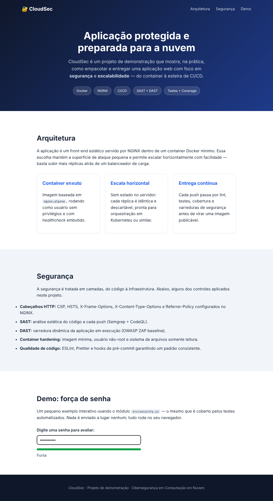

# CloudSec

Front-end estático de demonstração, **protegido e preparado para a nuvem**. O
objetivo do projeto é mostrar, em algo pequeno e fácil de rodar, uma arquitetura
web com foco em **segurança** e **escalabilidade**: do container à esteira de
CI/CD com análises de segurança automatizadas.



## :sparkles: O que tem aqui

- **Página estática** (HTML/CSS/JS) com um pequeno demo interativo de força de
  senha, que reaproveita o módulo coberto pelos testes.
- **Container endurecido**: imagem `nginx:alpine` mínima, rodando como usuário
  **não-root**, em porta não privilegiada e com `HEALTHCHECK`.
- **Cabeçalhos de segurança** no NGINX: CSP, HSTS, X-Frame-Options,
  X-Content-Type-Options, Referrer-Policy e Permissions-Policy.
- **Pipeline de CI** (GitHub Actions) com:
  - **SAST** — Semgrep e CodeQL;
  - **DAST** — OWASP ZAP baseline contra o container em execução;
  - **Testes + cobertura** — Vitest (100% no módulo de segurança).
- **Qualidade de código**: ESLint, Prettier, Husky e lint-staged.

## :rocket: Rodando localmente

### Com Docker (como seria na nuvem)

```sh
docker build -t cloudsec .
docker run --rm -p 8080:8080 cloudsec
# abra http://localhost:8080
```

### Sem Docker (só o front)

Basta abrir o `index.html` em um servidor estático (a importação de módulo ES
exige HTTP, não `file://`):

```sh
npx serve .     # ou: python -m http.server
```

## :test_tube: Desenvolvimento

```sh
npm install
npm run lint          # ESLint
npm run format        # Prettier (escreve)
npm test              # testes (Vitest)
npm run coverage      # testes + relatório de cobertura
```

Os hooks de pré-commit (Husky + lint-staged) formatam os arquivos alterados
automaticamente antes de cada commit.

## :file_folder: Estrutura

```
index.html                 # página
src/
  styles.css               # estilos
  security.js              # módulo de segurança (funções puras, testadas)
tests/
  security.test.js         # testes (Vitest)
Dockerfile                 # imagem endurecida (nginx não-root)
nginx.conf                 # configuração com cabeçalhos de segurança
.github/workflows/ci.yml   # SAST + DAST + testes + cobertura
```

> Projeto acadêmico de demonstração — Cibersegurança em Computação em Nuvem.
